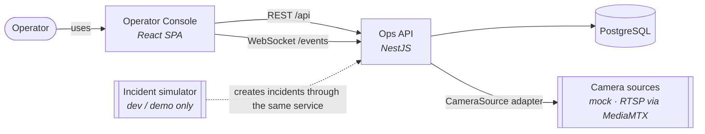
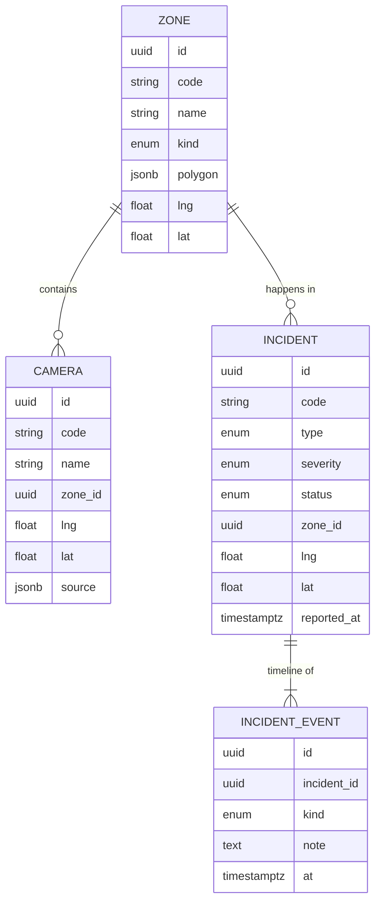
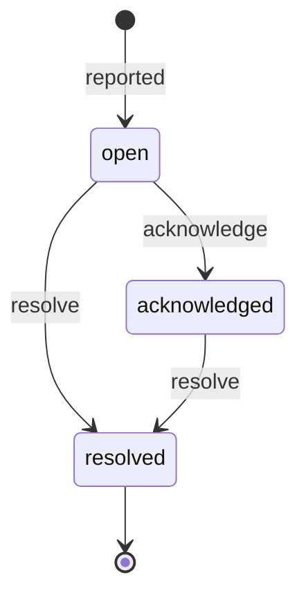
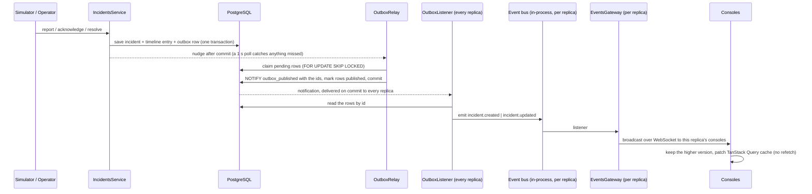
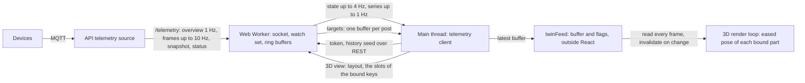

# Architecture

> Status: **M1 — Foundation**. This document describes the system as built and is updated with every milestone.

## 1. Problem

A campus operations team needs one screen that answers three questions at any moment:

1. **What is happening right now?** — open incidents, ordered by severity and age
2. **Where is it?** — on a map of the campus, next to the cameras that can see it
3. **Who is handling it?** — acknowledged, resolved, and the timeline of every change

The reference scenario is **Langbiang Tech Campus**, a fictional technology campus with buildings, parking, gates and outdoor areas. All data is synthetic.

### Quality goals

| Goal                  | What it means here                                                                                                  |
| --------------------- | ------------------------------------------------------------------------------------------------------------------- |
| **Live**              | A new incident reaches every open console in under a second, without refresh                                        |
| **Swappable sources** | Mock cameras in development, real RTSP/ONVIF cameras in production — same code path, chosen by configuration        |
| **Auditable**         | Every state change of an incident is recorded with a timestamp and its actor; transitions are validated server-side |
| **Runs anywhere**     | One `pnpm docker:stack` brings up the full stack on a single on-prem machine; no cloud dependency                   |

## 2. Context



## 3. Containers & packages

The repository is a **pnpm + Turborepo monorepo**. Apps are deployable units; packages are shared code with a single responsibility.

```
apps/
  api/               NestJS — REST, WebSocket gateway, persistence, simulator
  console/           React + Vite — operator console (map, 3D stage, feed, detail, camera tiles)
packages/
  contracts/         Shared types and event names: the API ↔ console contract
  camera-adapter/    CameraSource interface + implementations (mock now, MediaMTX next)
docs/
  architecture.md    This document
  adr/               Architecture Decision Records
  roadmap.md         Milestones and ticket breakdown
```

Dependency rule: **apps depend on packages, never on each other; packages never depend on apps.** `contracts` has no runtime dependencies at all.

## 4. Domain model



### Incident lifecycle



Transitions live in the `Incident` entity itself (`acknowledge()`, `resolve()`), not in controllers. An invalid transition throws a domain error, mapped to **HTTP 409 Conflict**. Every successful transition appends an `IncidentEvent` naming its actor (the signed-in user, or a system actor for the simulator and seed), so the timeline is the audit log ([ADR-0011](adr/0011-role-based-authorization-and-timeline-actor.md)).

## 5. Real-time flow



- The service never knows about WebSockets. It records a domain event; the gateway is one listener among potentially many (notifications, metrics…). See [ADR-0003](adr/0003-realtime-domain-events-socketio.md).
- The event is written to the `outbox` table **in the same transaction** as the change, so it exists exactly when the change committed: a rolled-back change has no event, and a committed one always gets published, even if the process dies right after the commit. `OutboxRelay` publishes pending rows when nudged, every second, and at boot. See [ADR-0007](adr/0007-transactional-outbox.md).
- Delivery is **at-least-once**: after a crash an event can be published twice, and events are ordered only within one relay batch. Every listener must tolerate both.
- **Every replica broadcasts every event.** The relay announces each batch with a Postgres `NOTIFY` of its outbox ids, sent only when the batch commits. Each API replica's `OutboxListener` reads those rows and emits them on its own bus, so a console sees a change whichever replica made it. No broker is involved. See [ADR-0008](adr/0008-multi-replica-fan-out.md).
- If a replica's LISTEN connection drops, its consoles miss notifications until it reconnects. It then closes their connections, and they reconnect and refetch once (the same recovery as any reconnect).
- On reconnect, the console refetches once to recover anything missed while offline.
- Events, HTTP responses and refetches can arrive in any order. Every incident carries a `version`, and the console keeps whichever copy has the higher one, so a late response or refetch never overwrites a newer event (see [events.md](api/events.md)).

### Telemetry path

Equipment readings take a separate, best-effort route. They never go through the outbox, and an incident event never goes through this one ([ADR-0019](adr/0019-telemetry-transport.md)).



- **Best-effort, latest wins.** The API emits overviews and frames as `volatile` packets, so a console that cannot keep up skips them and the next one corrects it. A snapshot after connect and after each watch change, and the upstream status, are always delivered.
- **The worker owns the socket.** It connects with the token the main thread gives it for each handshake, sends the watch set (at most four assets, at most four times a second), keeps a ring buffer (900 points, one per second) for each numeric or boolean key of a watched asset, and posts only what changed. The main thread never handles a message per reading. Where there is no `Worker` the same engine runs on the main thread.
- **Two WebSockets.** The worker is another JavaScript context, so its socket is not multiplexed with `/events`; each console makes two handshakes.
- **Freshness is computed from the state, on the server's clock.** The console never judges an asset against its own clock; see ADR-0019 § Freshness.
- **One store, read per asset.** The main thread mirrors the client's view into one store (`useTelemetryStore`). A component reads the smallest slice it needs: one asset's latest values, one key's series, the server's clock (re-read once a second) or the pill's status. A reading for one asset therefore does not render another asset's screen, and the ticking clock stays out of the live regions: the state word is announced, the age is not.
- **The watch set has one owner.** A component that lives as long as the console (`TelemetryWatchSet`) derives what the console wants every reading of: the asset open in the inspector first, then the asset of the open incident while a telemetry rule's incident is unresolved, at most four, sent once it has held still for 200 ms. The incident sheet and the inspector exclude each other in the console's store, so today the set holds one of them; the server delivers both. Whatever reads a reading (the inspector, the evidence block) only reads.
- **The console describes an incident, it never decides one.** The API's rule evaluation raises it ([ADR-0018](adr/0018-assets-and-telemetry-as-domain-data.md)). The console reads why from the incident's own record, the note of the first timeline entry, over `GET /incidents/:id` and not over this route: the sheet's "Why it was raised" block does, and so does the reading in the new-incident toast (the live event carries no timeline, so the toast is shown at once and gets the reading from one fetch, in place). Incident events and readings stay on their own paths.

#### The 3D branch

The 3D view moves the parts of a model with the same readings, on a path of its own that never passes through React state ([ADR-0020](adr/0020-digital-twin-rendering-and-model-pipeline.md) § State).

- **Layout and buffer.** The slots are the bound keys of every asset of every modelled class, read from each model's glTF `extras`. When a class's model has been read, the loader tells the feed (`setBindings`); the main thread sends the worker a `layout` (a number and the slots) only when it differs from the last one, and an empty one when the feed is disposed. The worker builds one `Float32Array` per post from its state, encoded against the layout (`NaN` for a value it does not have yet), posts it only when a slot changed, at most about 58 times a second, and echoes the layout's number so the client drops a buffer built for an older layout.
- **Outside React.** The client keeps the latest buffer. `twinFeed`, which is neither a React module nor `three`, reads it together with per-asset flags that need the catalogue, the incidents and the server's clock: `stale`, `online`, `alarm`, and the point the rule watches once the incident's detail is cached. It calls one injected `invalidate()` when a buffer arrived or a flag changed, so the on-demand canvas draws a frame. No reading is ever React state: `twinFeed.test.ts` drives it and sees no store change, and `twinPath.test.ts` checks that the modules on the path hold no state hook and write to no store.
- **What is eased where.** The worker encodes and never eases. The render loop (one `useFrame` for every model instance) eases each bound part toward its slot, caps the visual speed of a spinning part, snaps on the first value after a model loads and after a reconnect, freezes a stale or offline asset where it stands (a fan does not run down, which would read as a stop), and allocates nothing per frame. The canvas is drawn on demand and keeps drawing only while a value has not settled or a part spins. Stale and alarm are painted from the flags on shared materials: a stale asset is grey with dashed edges, and a fault keeps its severity edge.
- **What only a watched asset moves.** The buffer carries the overview's values for every asset (once a second) and the frames of the watched ones (up to ten a second). A part bound to a point that is not a headline or state point has a value only while its asset is watched, so for any other asset it rests at its authored pose. The watch set is still the one `TelemetryWatchSet` derives above, and the 3D side adds nothing to it; a test checks that nothing in `src/twin/` asks for a watch.

### 3D stage

The console's stage is the 2D map or, where the 3D view is in effect, a three.js scene of the campus ([ADR-0020](adr/0020-digital-twin-rendering-and-model-pipeline.md)). It reads no API endpoint of its own: it draws the zones, the site plan, the cameras and the asset catalogue the 2D map already loads, and the class models from `/models/`; the equipment's readings arrive by the telemetry path above ([The 3D branch](#the-3d-branch)).

- **A lazy chunk behind one import.** `StageView` loads `src/twin/` with a single dynamic `import()`, and only `src/twin/` may import `three` or `@react-three/*`. The 2D view, the fallback and the sign-in screens therefore download none of it, and the build fails if the chunk exceeds its gzip budget.
- **The main chunk owns the frame around it.** The `Campus 3D view` region, the loading card (the site plan and the 3D code as steps, with a Retry when the site plan fails) and the load-failure fallback are main-chunk code, because they show before the twin chunk exists.
- **It falls back to the 2D map, and says why.** If WebGL 2 is missing, or the context is lost and does not come back within 5 seconds, the stage is the 2D map again, a banner gives the reason, and the 3D option stays disabled with the same words. The operator's stored choice is kept, so a reload tries 3D again.
- **It is the default where WebGL 2 works.** The stage opens in 3D on a device that can create a WebGL 2 context, unless the operator stored a choice of 2D; the switch and the fallback above are the 2D map. The check reads no session or permission, so the stage is the same for every role, and it is not a security control: authorization stays on the server.
- **The Assets tab and the inspector are the accessible twin.** A WebGL canvas is opaque to assistive technology, so the picture is one focusable group with a text summary of the site and its active incidents, the canvas inside it is hidden, and the camera controls and the legend are ordinary buttons with their own tab stops. The summary counts incidents with the same rule as the feed and the KPI tiles.
- **The heat overlay is a layer, and the lists carry its numbers.** With the Heat layer on (off by default and not remembered), at the campus and at a building in focus, each building takes a colour from the mean of its fresh `indoorTempC` readings on a fixed 19 – 27 °C scale, and a building with no fresh reading is faded and reads "No data". It uses the one-second overview the telemetry path already carries, so it adds no endpoint, event or permission. The canvas stays hidden from assistive technology, so the same numbers are on the Assets tab and in the building card, and the stage's summary says what the colours mean ([ADR-0020](adr/0020-digital-twin-rendering-and-model-pipeline.md)).
- **The stage has its own keys, scoped to its focus.** While the 3D view (its one tab stop) has focus, the arrows orbit and tilt, `Shift` and the arrows pan, `+` and `-` zoom, `Home` resets to the campus view and `Esc` goes up one level (part, asset, building); a key the view does not use, such as `Tab`, `V`, `F`, `?` or an `Esc` at the campus, is left to its own handler, so `Home` and the arrows keep their meaning in the lists. The keys reach the camera through the same commands as the on-screen buttons and the level through the store (the camera follows the level by itself), and because they act only on focus they are not behind the single-key switch ([ADR-0020](adr/0020-digital-twin-rendering-and-model-pipeline.md) records the decisions).

#### Video wall

A control-room screen is a window of the console opened as `…/?wall=N` ([ADR-0020](adr/0020-digital-twin-rendering-and-model-pipeline.md), "Settled in V2-21.1"): a mode of the same app, not a second one, because an app may not import another app (ADR-0001) and only `src/twin/` may import `three`. It adds no endpoint, event, permission or environment variable.

- **How a window becomes a wall.** `N` is a positive integer, the number in "Wall N · view only". The sign-in redirect would lose the query string, so `main.tsx` keeps it in the tab's `sessionStorage` before sign-in starts; anything else in the address is ignored. The store reads it once, so a wall is a different window, not a mode that is switched.
- **What it shows.** The header (the four severity counts, the two connection states, the screen's number, the clock), the stage, the camera grid with the incident's zone first and the active incidents, scaled from the window's width (1.35 at 1920 px, 2.7 at 3840). The stage is the twin held still: a locked camera, pixel ratio 1.0, markers at the wall's scale, no heat overlay, and none of the controls, legends or callouts. Where WebGL 2 is missing, the context is lost, or frames stay too slow for a minute (`FrameGuard`), it is the 2D map with a tag that says why; it does not go back to 3D until the page is reloaded.
- **What moves the camera.** Nothing but a new critical incident. `useWallFocus` reads the difference between two reads of the incident list the query cache holds (`lib/wall/wallFocus.ts`, pure), flies the camera to that incident's beacon, shows the banner with a countdown, and returns to the fixed campus view after 60 s or when the incident is acknowledged, resolved or removed. A second critical replaces the first. It never rotates when idle, and it writes the wall's own `wallFocusId`, never `selectedIncidentId`, which would open a sheet.
- **What it never does.** It mounts no control for any role, so a wall is read-only for an operator as for a viewer; the account it signs in with is a `viewer`, and the API remains the control (ADR-0011). It shows no toast, plays no sound, takes no key, and calls no write route. The telemetry watch is the focused asset's only, inside the limit of four.
- **Staying signed in.** A failed renewal keeps the last data on screen with "Session reconnecting…" in the header and signs the wall in again without a click (`useWallReauth`): at once the first time, then no more than once a minute and backing off to 15 minutes, never before the identity provider answers. Keycloak's remember-me session limits, which the realm sets, decide how long that works; at the limit the wall waits on the sign-in page for a person. How to run one: README, "Video walls".

### Incidents in 3D

Incidents are drawn in the 3D stage, the camera moves for them only when the operator asks, and the report form can pick its location in the scene ([ADR-0020](adr/0020-digital-twin-rendering-and-model-pipeline.md) records the decisions). None of it adds an endpoint, an event or a permission: it reads the incident list the feed and the 2D map already hold.

- **Beacons are the 2D map's set.** One beacon stands for each active incident, plus the selected one even when resolved (`isActive`, the rule of the feed and of `incidentFeatures`), at the map's fanned-out position, on the top of the incident's asset, on the roof of the building it is inside, or on the ground. A beacon is a screen-sized sprite (ground ellipse, stem, a disc with the type's glyph, filled while open and hollow while acknowledged, larger and pulsing for a critical open one, the asset's code on a tag for a telemetry incident, an accent ring when selected), drawn in one draw call over all geometry and never faded, so an incident behind a wall is still seen; the pulse stops under reduced motion. It is hit in screen space on its disc before any geometry: a click selects the incident and a second click on the selected one deselects it, and a hover shows the 2D map's incident tooltip. The Incidents layer switches them off.
- **The camera moves only on request.** An incident arriving, being selected from the feed, the search or a beacon, and the toast's "Open incident" move nothing. In the 3D view the toast of a new critical or high incident offers "Fly to", which selects the incident and then flies to its beacon from where the camera is, no farther than 120 m, keeping its yaw and tilt; in 2D the toast keeps its single "View incident". The incident sheet's "Show in 3D", on the asset link of a telemetry incident, frames the asset without selecting it (from at least 60 m, so the sheet stays open and no asset is isolated); from the 2D map it switches the view first and the flight waits for the stage to mount. Both are available to every role, because they only read.
- **A location is picked in the scene.** While the report form's "Pick in 3D" is on, a click hits the nearest of the building shells (roofs included) and the ground plane, nothing else, and the point goes through the rule the 2D map uses (`zoneAt`, the API's own): inside a zone the pin is placed there and that zone is selected, outside every zone the pin stays and the form says so. The pin is a screen-sized sprite at the roof's height when its position is inside a building's footprint, stays put while the camera orbits and can be dragged without the camera moving; Escape stops picking. The API still refuses a pin outside its zone, and `incident:report` still decides who can report.
- **Reaching them without the canvas.** The canvas is hidden from assistive technology and pointer-only. The incident feed lists every incident a beacon stands for, the stage's summary counts the active incidents by the same rule, and the sheet's buttons, the toast's actions and the form's zone select and "Pick in 3D" toggle are ordinary buttons, so everything a beacon or the pin does can be done from them.

## 6. Camera sources

```ts
interface CameraSource {
  readonly kind: string;
  resolveStream(camera: CameraRef): Promise<StreamDescriptor>;
}
```

The API resolves a camera to a `StreamDescriptor` (`{ kind: 'mock' }` today, `{ kind: 'hls' | 'webrtc', url }` with MediaMTX). The console renders whatever descriptor it receives. Switching from mock to real cameras is an environment change (`CAMERA_SOURCE=mediamtx`), not a code change. See [ADR-0002](adr/0002-camera-source-adapter.md).

## 7. Deployment

The repository ships a Docker Compose stack for demos and evaluation, not a production deployment. It runs on a single host: `postgres`, `api`, `keycloak` and `console` (static build served by nginx, which also reverse-proxies `/api` and `/socket.io` — the transport for the `/events` namespace — to the API, and `/auth` to Keycloak; one origin, no CORS). nginx is also the edge rate limiter, per client address, and the only place that decides the client address the API trusts ([ADR-0012](adr/0012-rate-limiting.md)). On boot the API runs pending migrations and seeds the reference campus when the database is empty.

Keycloak is the demo identity provider ([ADR-0010](adr/0010-oidc-authentication.md)): dev mode, plain HTTP, and a realm with demo users re-imported from `docker/keycloak` on every start. Its sign-in page is the `occ` login theme (`docker/keycloak/themes/occ`), mounted read-only into the container: a public page in the console's look over a pre-rendered, unlabelled campus, so it shows no site data and calls no API, with the same picture behind the console's own sign-in states. The API fetches its signing keys on first use and does not depend on it to boot; while it is down, authenticated requests get `503`.

The API can run as several replicas (`pnpm docker:stack:replicas`; [ADR-0008](adr/0008-multi-replica-fan-out.md)):

- The `api` service publishes no host port. nginx round-robins across all replicas and re-resolves them through Docker DNS.
- No sticky sessions are needed, because the `/events` namespace accepts WebSocket only.
- Replicas booting together take turns: migrations and the seed run under Postgres advisory locks.
- Only the replica holding the simulator lock runs the simulator. Another takes over if it dies.

A production deployment guide is not published yet.

## 8. Cross-cutting concerns

| Concern                    | Approach                                                                                                                                                                                                                                                                                     |
| -------------------------- | -------------------------------------------------------------------------------------------------------------------------------------------------------------------------------------------------------------------------------------------------------------------------------------------- |
| Configuration              | `@nestjs/config`, validated at startup — the API refuses to boot with invalid env                                                                                                                                                                                                            |
| Validation                 | `class-validator` DTOs + global `ValidationPipe` (whitelist, forbid unknown)                                                                                                                                                                                                                 |
| Errors                     | Domain errors mapped to HTTP status in one exception filter; consistent error body                                                                                                                                                                                                           |
| Schema changes             | TypeORM migrations only; `synchronize` is never enabled                                                                                                                                                                                                                                      |
| Event delivery             | Transactional outbox + relay; at-least-once, clients keep the higher `version` ([ADR-0007](adr/0007-transactional-outbox.md)); Postgres `NOTIFY` fans out to every replica ([ADR-0008](adr/0008-multi-replica-fan-out.md))                                                                   |
| Retries / duplicate writes | `POST /api/incidents` takes an optional `Idempotency-Key`; the key and the first response commit with the incident, so a retry replays it instead of creating a duplicate ([ADR-0009](adr/0009-idempotent-incident-creation.md))                                                             |
| Identity / access          | OIDC access tokens from Keycloak, checked on every route but health and at the `/events` handshake ([ADR-0010](adr/0010-oidc-authentication.md)); writes need `operator` or `supervisor`, a user with no role gets 403 ([ADR-0011](adr/0011-role-based-authorization-and-timeline-actor.md)) |
| API docs                   | OpenAPI generated from code at `/api/docs`; off by default in production ([ADR-0005](adr/0005-api-docs-exposure-per-environment.md))                                                                                                                                                         |
| Quality gates              | ESLint, typecheck, unit + e2e tests and build on every push (GitHub Actions)                                                                                                                                                                                                                 |

## 9. Decisions

| ADR                                                             | Decision                                                 |
| --------------------------------------------------------------- | -------------------------------------------------------- |
| [0001](adr/0001-monorepo-pnpm-turborepo.md)                     | Monorepo with pnpm workspaces and Turborepo              |
| [0002](adr/0002-camera-source-adapter.md)                       | Camera access behind a `CameraSource` adapter            |
| [0003](adr/0003-realtime-domain-events-socketio.md)             | Domain events in-process, broadcast with Socket.IO       |
| [0004](adr/0004-postgres-typeorm-migrations.md)                 | PostgreSQL with TypeORM, migrations only                 |
| [0005](adr/0005-api-docs-exposure-per-environment.md)           | API docs exposure per environment                        |
| [0006](adr/0006-config-and-secrets-per-environment.md)          | Configuration and secrets per environment                |
| [0007](adr/0007-transactional-outbox.md)                        | Transactional outbox for incident events                 |
| [0008](adr/0008-multi-replica-fan-out.md)                       | Several API replicas, events fanned out through Postgres |
| [0009](adr/0009-idempotent-incident-creation.md)                | Idempotent incident creation with an `Idempotency-Key`   |
| [0010](adr/0010-oidc-authentication.md)                         | OIDC authentication for REST and WebSocket               |
| [0011](adr/0011-role-based-authorization-and-timeline-actor.md) | Role-based authorization and the timeline actor          |
| [0013](adr/0013-liveness-and-readiness-probes.md)               | Separate liveness and readiness probes                   |
| [0017](adr/0017-site-plan-as-data.md)                           | Site plan and camera fields of view served by the API    |
| [0022](adr/0022-console-visual-language.md)                     | Console colour, neon and camera rules                    |
| [0023](adr/0023-building-levels-as-data.md)                     | Building levels as data                                  |
| [0024](adr/0024-shift-handover.md)                              | Shift handover as its own record                         |
| [0031](adr/0031-place-plans.md)                                 | Place plans: rooms and positions                         |
| [0032](adr/0032-source-layout-by-feature.md)                    | Source layout: feature folders, relative imports         |
